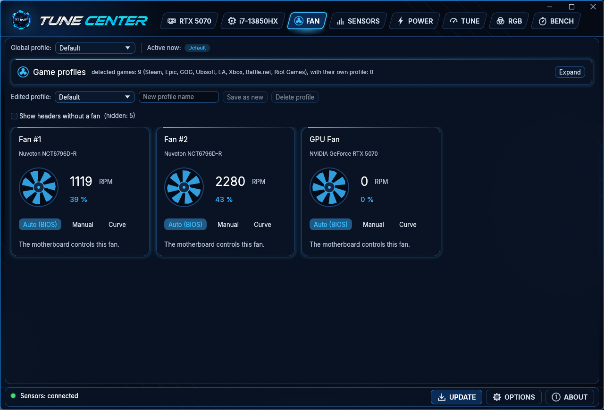
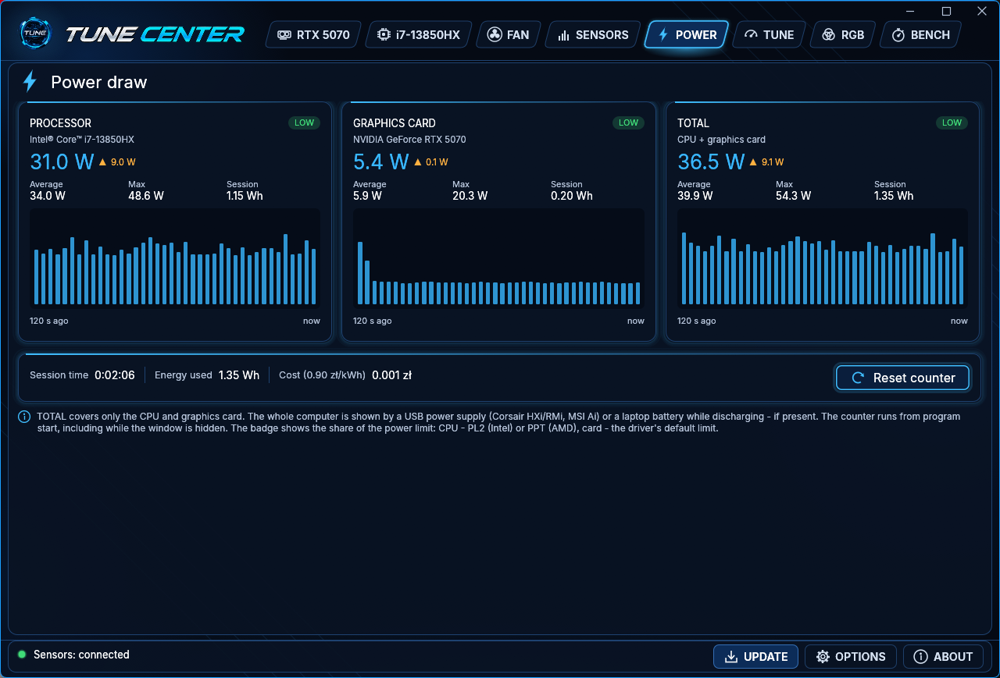
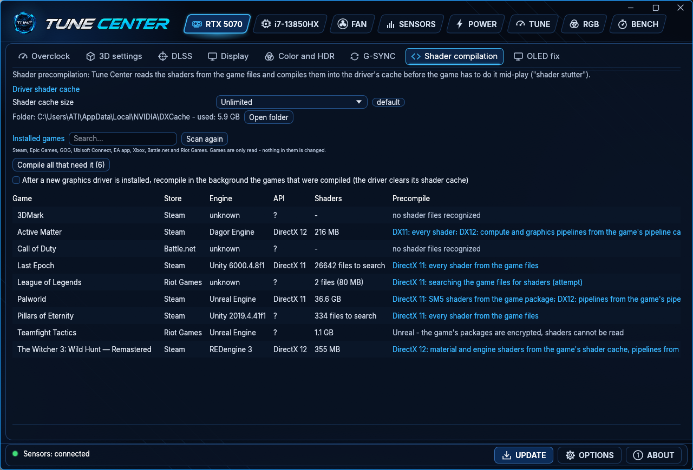
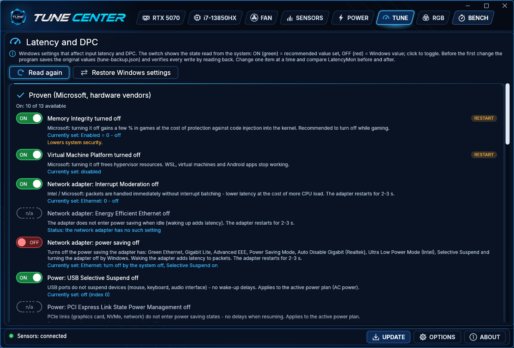
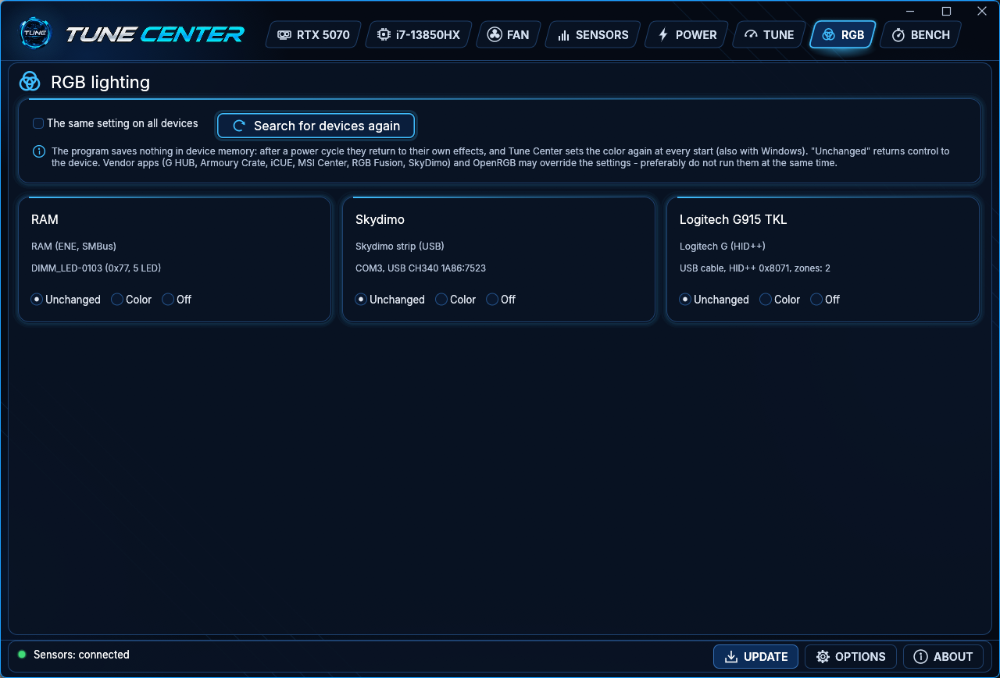
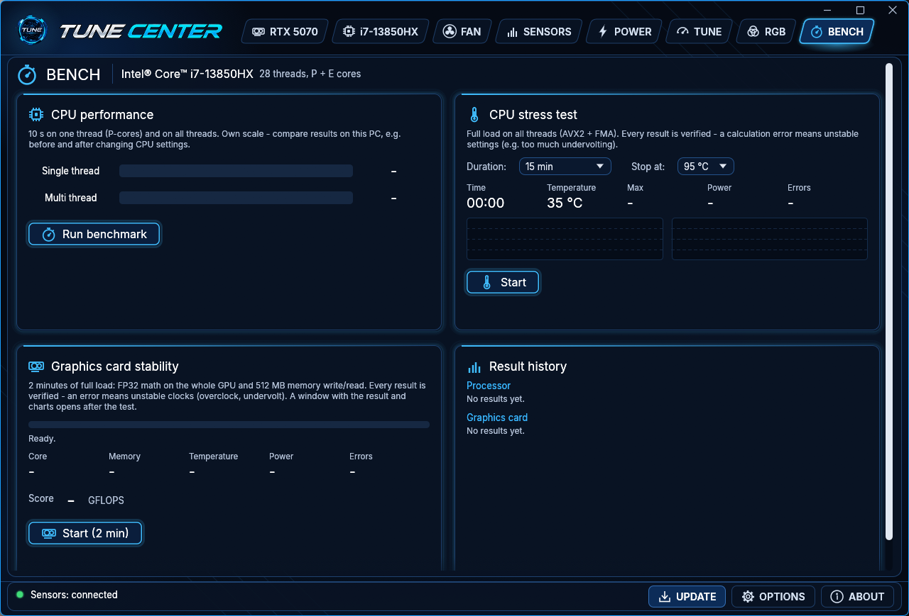

<div align="center">


# Tune Center

**One window to tune and monitor your Windows gaming PC.**<br>
GPU overclocking and V/F curve, NVIDIA driver settings and DLSS overrides, CPU power limits and undervolting, fan curves, sensors, power draw and Windows latency tweaks – in a single lightweight app.

[](https://github.com/Atimaniac/tune-center/releases/latest)
[](https://github.com/Atimaniac/tune-center/releases)


[](LICENSE)

### [⬇ Download the latest installer](https://github.com/Atimaniac/tune-center/releases/latest)


</div>

---

## Why Tune Center?

Most PC tuning means juggling MSI Afterburner, NVIDIA App, Intel XTU or Ryzen Master, FanControl, HWiNFO and a handful of registry tweaks. Tune Center puts the everyday parts of all of them into **one native app** (Rust, ~10 MB) that starts with Windows, sits in the tray and gets out of your way.

- 🎮 **GPU** – core/memory clock offsets, a drag-and-drop **V/F curve editor** for undervolting, 5 profiles, apply on startup.
- 🟢 **NVIDIA control panel** – 3D settings (global and per game), **DLSS overrides like the NVIDIA App** (presets, mode, Frame Generation), display, color/HDR, G-SYNC – using only the public NVAPI SDK.
- 🔴🔵 **RADEON and INTEL** – AMD cards get 3D settings, FSR and FreeSync; Intel Xe and Arc get 3D settings, ARC SYNC and display; older Intel graphics get a basic panel with Windows display and graphics settings.
- ⚡ **Shader pre-compilation** – compile a game's shaders ahead of time, from the game files alone (Unity, Unreal Engine DX11 and DX12, Dagor, Source 2, REDengine 3, RAGE, ForzaTech, Santa Monica, Northlight, Luminous, Frostbite, CRYENGINE, Snowdrop, Nixxes, Stingray, Tank, Zouna, Dawn, DirectX 12 games whose shaders carry their root signature and other DirectX 11 games) so the first match doesn't stutter, and clean the shader cache with one click.
- 🧠 **CPU** – Intel PL1/PL2, voltage offsets, IccMax and turbo ratios with an XTU-style live monitor; AMD Ryzen Curve Optimizer per core and PBO limits.
- 🌀 **Fans** – motherboard and GPU fans: auto, fixed or temperature curve, with profiles that switch automatically while a game runs.
- 🌡️ **Sensors & power** – key temperatures and CPU/GPU power with 2-minute charts, session energy and its cost.
- 🛠️ **TUNE** – Windows latency and DPC settings with a backup of the original values and one-click restore.
- ⏱️ **BENCH** – CPU-Z-style single-thread and multi-thread score, a CPU stress test that verifies every calculation (catches unstable undervolts) and stops at a temperature limit, and a 2-minute graphics card stability test with a result window, clock/temperature/power charts and a comparable score.
- 💡 **RGB** – one tab for all lighting: one color (with brightness), hardware effects (breathing, flashing, color cycle, rainbow wave – whatever the device supports) with speed, or off, on every device or per device, or leave it to the device. RAM with an ENE controller (G.Skill Trident Z RGB and others, Intel and AMD chipsets), Corsair RAM (Vengeance RGB PRO), Skydimo LED strips, Logitech G keyboards and mice (HID++), NVIDIA cards with lighting zones in the driver, and – not yet tested on real hardware – ASUS Aura (USB), Gigabyte RGB Fusion 2 (USB), Corsair Lighting Node / Commander Pro and MSI Mystic Light. Nothing is written to device memory.
- 🔄 **Auto-update** – checks GitHub every 15 minutes and updates silently with one click; also notifies you about new NVIDIA Game Ready drivers and installs just the driver with one click.

## Screenshots

<table>
<tr>
<td width="50%"><br><b>NVIDIA</b> – GPU-Z style sensors with full-width live charts</td>
<td width="50%"><br><b>CPU</b> – XTU-style monitor with per-core temperature, clock and VID</td>
</tr>
<tr>
<td><br><b>FAN</b> – motherboard and GPU fans with profiles and curves</td>
<td><br><b>SENSORS</b> – key temperatures with status badges and charts</td>
</tr>
<tr>
<td><br><b>POWER</b> – CPU and GPU power draw, load against the power limit, session energy and cost</td>
<td><br><b>Shader compilation</b> – installed games, their engine and what can be compiled ahead of time</td>
</tr>
<tr>
<td><br><b>TUNE</b> – Windows latency and DPC settings with a backup of the originals</td>
<td><br><b>RGB</b> – one tab for RAM, LED strips, peripherals and the graphics card</td>
</tr>
<tr>
<td colspan="2" align="center"><br><b>BENCH</b> – CPU score, stress test and graphics card stability test</td>
</tr>
</table>

## Features

### NVIDIA
- **Overclock** – core and memory offsets; **V/F curve editor** (drag points, *flatten to the right* for undervolting, same offset everywhere); profiles 1–5 with export/import; apply a profile with Windows (with a crash-loop guard).
- **Info** – GPU-Z style rows: clocks, memory temperature, memory used, GPU / video engine / bus load, encoder, decoder, voltage; less important readings (PCIe TX/RX, power, % TDP) behind a *Hidden* button. Hover any chart for the exact value.
- **3D settings** and **DLSS** – the NVIDIA Control Panel / NVIDIA App options, globally or per game, with a backup before the first change.
- **Display, Color and HDR, G-SYNC** – resolution and refresh rate (with 15 s confirmation), color depth, HDR, VRR.
- **Shader compilation** – detects games from Steam, Epic, GOG, Ubisoft, EA, Xbox, Battle.net and Riot Games; pre-compiles shaders for Unity (DX11), Unreal Engine (DX11 from unencrypted `.pak` or IoStore games such as Palworld; DX12 pipelines from the game's `.upipelinecache` or, without one, from its SM6 shader maps with the root signatures of the engine version, UE 4.20–5.8), Dagor Engine (DX11; DX12 compute and graphics pipelines from the game's `cache\dx12.cache`), Source 2 (DX11, e.g. Counter-Strike 2), REDengine 3 (DX12, The Witcher 3: pipelines from the game's shader cache and techniques), RAGE gen9 (DX12, GTA V Enhanced), ForzaTech (DX12, Forza Horizon), Santa Monica (DX12 God of War Ragnarök, DX11 God of War), Northlight (DX12, Control), Luminous Studio (DX11, Final Fantasy XV), Frostbite (DX11), CRYENGINE (DX12, Hunt: Showdown), Snowdrop (DX12, Star Wars Outlaws), Nixxes (DX12, Ghost of Tsushima, Ratchet & Clank), Stingray (DX11, Helldivers 2), Tank (DX11, Overwatch), Zouna (DX12, A Plague Tale: Requiem), Dawn (DX12, Guardians of the Galaxy), DX12 games of any engine whose shaders carry an embedded root signature (carved from the game files, vertex and pixel shaders paired by their signatures) and other DX11 games with loose shader files; on AMD and Intel DX11 shaders also get the input layout from their signature; `tunecenter.exe --shader-report [game]` writes a read-only report `tunecenter-shaders.txt` of what it finds in each game; a *Status* column shows when each game was compiled and marks it again when a new NVIDIA driver (which clears the shader cache) or a game update needs a recompile; *Compile all that need it* queues the games and compiles them one after another, optionally on its own in the background after a driver update; the game's cache size is measured after compiling; *Clean shaders* removes the game's NVIDIA and Windows (D3DSCache) shader caches.
- **OLED fix** – one-click `vrrFrameSplitBehavior` driver tweak: with G-SYNC the driver keeps a 1× frame multiplier down to 48 FPS instead of doubling (e.g. 60 FPS → 120 Hz), which removes VRR brightness flicker on OLED monitors; re-applied automatically after a clean driver install.
- **System** – Hardware-accelerated GPU scheduling (HAGS) toggle and Resizable BAR status.
- **Driver updates** – checks the NVIDIA server for the latest Game Ready driver for your card (at startup and every 6 hours) and installs just the driver (with HDMI audio and PhysX, without NVIDIA App and telemetry) silently with one click.
- AMD Radeon cards: clock limits, sensors and fans; the tab is called RADEON and has 3D settings, FSR and FreeSync (AMD ADLX).
- Intel graphics: the tab is called INTEL – 3D settings (global or per game), ARC SYNC and display from the Intel driver (IGCL, Intel Xe and Arc). Graphics older than 11th-gen processors get a basic panel instead: display mode, scaling and HDR, HAGS, windowed game optimizations, Windows VRR and the GPU chosen for a game. Without an NVIDIA or AMD card the Overclock page is hidden.

### CPU
- **Intel** (12th–14th gen): PL1, PL2 and Tau, voltage offset per domain, Core IccMax, active-core turbo ratios (like XTU), live monitor (package/core temperatures, RAPL power, VID, clocks, throttling reasons).
- **AMD Ryzen** 5000/7000/9000: Curve Optimizer per core (optionally applied at Windows startup, turned off by itself after a freeze), PPT/TDC/EDC and PBO scalar; Ryzen 3000: PBO limits.
- Every write is verified by reading it back; settings last until reboot and are never applied automatically.

### FAN, SENSORS, POWER
- Motherboard fans (Nuvoton, ITE and Fintek Super I/O chips, read and controlled by the program itself through PawnIO - no background process; sensors and fans named for the specific board on about 300 ASUS, Gigabyte, MSI, ASRock, Biostar and EVGA models) and GPU fans (directly through the NVIDIA/AMD driver): auto, manual or curve from any temperature sensor; GPU fans return to auto above 88 °C.
- **Game profiles** – assign a fan profile to any game detected in Steam, Epic, GOG, Ubisoft, EA, Xbox, Battle.net or Riot Games (or any .exe); it switches on while the game runs and the global profile returns when it closes.
- Key temperatures (CPU, GPU, motherboard, disks, RAM) with NORMAL/HIGH/HOT badges, min/max and charts. When the motherboard's sensor chip can't be read, the board temperature comes from Windows ACPI thermal zones (only zones that actually change, not fixed BIOS values).
- CPU and GPU power with LOW/MEDIUM/HIGH load against the power limit, session energy and cost (price per kWh in OPTIONS).
- **Whole computer** – a discharging laptop battery shows the power draw of the whole PC, next to the CPU + GPU total.

### TUNE – System, DPC, Fast Load, Power plan
Windows and driver settings recommended by Microsoft, NVIDIA and hardware vendors (Memory Integrity, Virtual Machine Platform, NIC interrupt moderation, EEE and vendor power saving (Green Ethernet, Gigabit Lite, Selective Suspend and more), USB selective suspend, PCIe link power management, CPU core parking off, Ultimate Performance plan, mouse acceleration off, SysMain off on SSD-only PCs, NVIDIA V-Sync + frame cap below the refresh rate for G-SYNC, Low Latency Mode) plus settings to test on your own hardware (NVIDIA maximum performance power mode, MSI interrupt mode per device, memory compression off, Fault Tolerant Heap off, fast startup off, Win32PrioritySeparation, SystemResponsiveness, Multi-Plane Overlay off). Every option shows its current value; the original values are backed up before the first change.

**DPC analyzer** – a simple LatencyMon-style measurement without a driver of its own: how long each driver holds a processor in DPC routines and interrupt handlers (longest, average, count, total), hard page faults, the share of CPU time in DPC/ISR and the wake-up latency of a top-priority thread. It only observes the system (Windows ETW, administrator) for 15 s to 5 min, colours results (green below 0.5 ms, red above 1 ms) and keeps the previous result next to the new one, so you can check each *System* setting. The settings above are on the *System* page.

**Interrupt cores** (DPC page) – shows which processor core serves the graphics card (measured with a 2 s trace) and which one serves each audio device, including the USB controller a DAC is plugged into. When audio shares the graphics card's core, one button moves the audio controller to another core (the documented *Affinity Policy* registry entry, device restart) and *Undo* restores the previous state. Measured here: a top-priority thread on the graphics card's core was delayed by more than 0.5 ms 135 times in 30 s at idle, against 0–1 times on other cores.

**Keep the graphics card's core awake** (System page) – while a game runs, the processor core that executes the graphics driver's DPC routines is kept from sleeping by an empty loop at the lowest priority (the core is found with a 2 s trace; administrator). A core that wakes from sleep runs the same routines several times slower: on an i7-13850HX with an RTX 5070 the driver's longest DPC under load fell from 229–280 µs to 113–144 µs. Cost: that one core shows 100 % usage and draws more power.

**Fast Load (32GB RAM+)** – reads a game's files into free RAM before you start it, so the game gets them from memory instead of the disk. Game files are not changed and nothing is injected into the game. The list shows every detected game with its size, drive type (NVMe / SATA SSD / HDD) and **DirectStorage readiness**: whether the game ships `dstorage.dll` (and which version), whether it sits on an NVMe drive and whether Windows allows BypassIO there. *Learn* records which parts of the files the game actually reads (Windows ETW, administrator, observation only) – afterwards only that data is loaded, which also fits games larger than the free memory. *Keep in memory* holds the loaded data in Tune Center's own memory until you release it, the game closes or the system runs low on memory. Selected games can load by themselves 2 minutes after the program starts. The gain is largest on SATA drives and HDDs; games that use DirectStorage or unbuffered reads do not benefit.

**Power plan** – turns on a chosen Windows power plan while a game runs (for example Ultimate Performance, with core parking off) and returns to a second chosen plan when the game closes. A plan changed by hand between games is left alone.

### BENCH
Single-thread and multi-thread CPU score (10 s each, own scale for before/after comparisons on the same PC) with a history of the last 10 results. Stress test on all threads (AVX2 + FMA when available) for 5–60 minutes or until stopped: live CPU temperature and power charts, automatic stop at 85/90/95 °C, and a count of calculation errors – any error means the CPU settings are unstable.

**Graphics card stability** – 2 minutes of full load through Direct3D 11: FP32 math on the whole GPU, a power-heavy mixed memory + math pass and write/read checks of 512 MB of video memory. Every calculation and memory read is verified, so an unstable overclock or undervolt shows up as errors. When the test ends, a window shows the score (GFLOPS FP32 and memory GB/s), STABLE / UNSTABLE, the comparison with your best result, and average/min/max with 2-minute charts of core clock, memory clock, temperature and power draw. Results are kept in the history.

### OPTIONS and ABOUT
Both open from the buttons next to *UPDATE* in the bottom-right corner. Polish / English, start with Windows, minimize to tray (single instance – starting it again brings the window back), themes (Tune with an optional light variant, Neon Green, Neon City, Crimson), update checks, energy price, **compatibility check**. ABOUT shows the version, the author, a link to this repository and the license notice. Lighting moved to the RGB tab in 0.28.0 (settings are carried over).

## Installation

1. Download **`TuneCenter-Setup.exe`** from the [latest release](https://github.com/Atimaniac/tune-center/releases/latest).
2. Run it. The installer offers to install the **PawnIO** driver (through winget) if it is missing. No .NET or other runtime is needed.
3. Start Tune Center. Later updates install from the app with one click (*UPDATE*, bottom right).

Running as administrator is optional – the GPU, NVIDIA settings, shader compilation, disks and GPU power work without it. CPU tuning, CPU temperature and power, motherboard fans and some TUNE items need administrator rights (a button in the status bar restarts the app elevated).

### Requirements
- Windows 10 or 11, 64-bit
- NVIDIA (GTX/RTX), AMD Radeon or Intel graphics with a current driver
- [PawnIO](https://pawnio.eu) – optional; needed for CPU tuning, CPU, motherboard and RAM sensors, motherboard fans and RAM lighting (installed by the setup)

### If something goes wrong
**Something does not work on your hardware?** Run *OPTIONS > Compatibility check* (or `tunecenter.exe --diagnose`). It only reads - CPU registers, graphics driver functions, sensors, disks, RGB devices, TUNE items, games - and writes `tunecenter-diagnostics.txt` without serial numbers or your user name. *Report on GitHub* copies the report and opens a ready [compatibility issue](https://github.com/Atimaniac/tune-center/issues/new?template=compatibility.yml) - paste it with Ctrl+V. With it, support for new hardware can be fixed without access to it.

When Tune Center crashes, a window shows what happened at the next start (error code, the module that failed). The report is saved next to the program in `tunecenter-crash.log` – please attach it to a [GitHub issue](https://github.com/Atimaniac/tune-center/issues).

## ⚠️ Disclaimer

Tune Center changes clocks, voltages, power limits, fan speeds and system settings. Overly aggressive values can make your PC unstable or reduce cooling. Change one thing at a time and test stability. You use the program at your own risk.

## Building from source

```powershell
# Rust (stable, MSVC), Inno Setup 6
.\build.ps1             # cargo build --release, PawnIO modules -> dist\
.\build-installer.ps1   # installer -> installer-output\TuneCenter-Setup.exe
```

## Privacy

Tune Center has no telemetry, accounts or ads. It contacts GitHub (program updates) and NVIDIA (driver updates) only to check for and download updates; both checks can be turned off. See [PRIVACY.md](PRIVACY.md).

## License

Tune Center – PC tuning and monitoring in one window<br>
Copyright (C) 2026 Atimaniac

This program is free software: you can redistribute it and/or modify it under the terms of the GNU General Public License as published by the Free Software Foundation, either version 3 of the License, or (at your option) any later version.

This program is distributed in the hope that it will be useful, but WITHOUT ANY WARRANTY; without even the implied warranty of MERCHANTABILITY or FITNESS FOR A PARTICULAR PURPOSE. See the GNU General Public License for more details.

You should have received a copy of the GNU General Public License along with this program. If not, see <https://www.gnu.org/licenses/>.

What this means in practice:

- You may use the program for any purpose, study and change its source code, and share copies – free of charge or for a fee.
- If you distribute the program or a modified version, you must do it under the same license (GPL-3.0-or-later), keep the copyright notices and make the complete source code available.
- There is no warranty, and the author is not liable for damage caused by using the program.

The full license text is in [LICENSE](LICENSE); it is also installed next to the program and summarised in the ABOUT tab. Third-party components keep their own licenses – see [THIRD-PARTY.md](THIRD-PARTY.md).

## Credits

Built with [egui/eframe](https://github.com/emilk/egui) and [PawnIO](https://pawnio.eu). See [THIRD-PARTY.md](THIRD-PARTY.md) for all components and references.

<sub>Polish documentation: [README.pl.md](README.pl.md)</sub>
