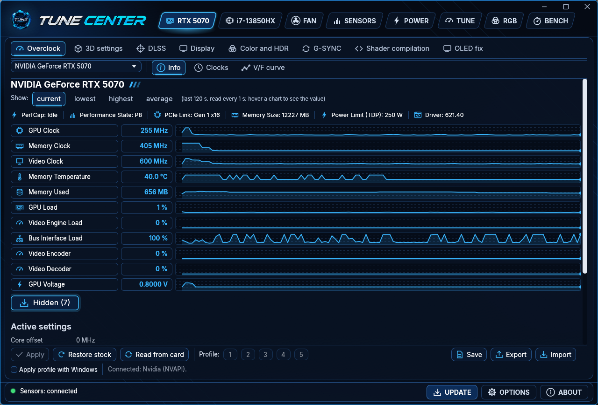
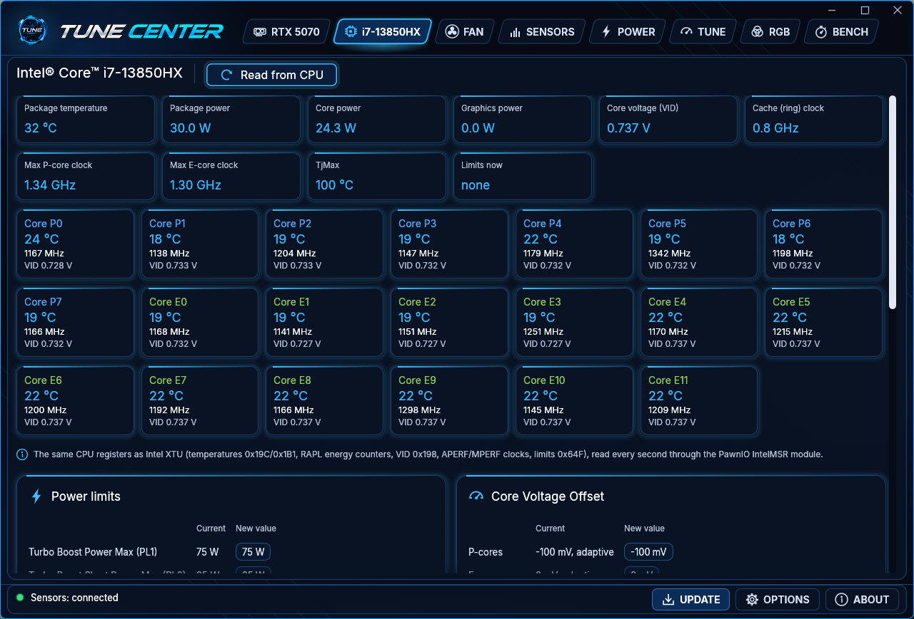
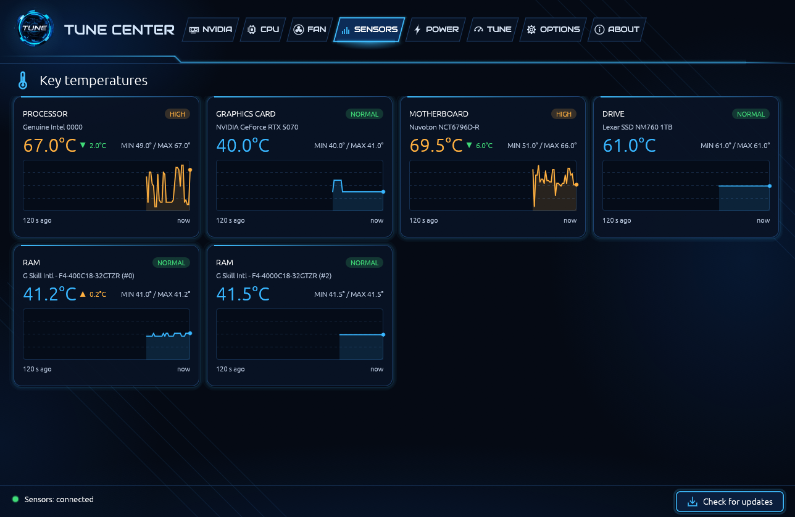

<div align="center">


# Tune Center

**One window to tune and monitor your Windows gaming PC.**<br>
GPU overclocking and V/F curve, NVIDIA driver settings and DLSS overrides, CPU power limits and undervolting, fan curves, sensors, power draw and Windows latency tweaks – in a single lightweight app.

[](https://github.com/Atimaniac/tune-center/releases/latest)
[](https://github.com/Atimaniac/tune-center/releases)


### [⬇ Download the latest installer](https://github.com/Atimaniac/tune-center/releases/latest)



</div>

---

## Why Tune Center?

Most PC tuning means juggling MSI Afterburner, NVIDIA App, Intel XTU or Ryzen Master, FanControl, HWiNFO and a handful of registry tweaks. Tune Center puts the everyday parts of all of them into **one native app** (Rust, ~10 MB) that starts with Windows, sits in the tray and gets out of your way.

- 🎮 **GPU** – core/memory clock offsets, a drag-and-drop **V/F curve editor** for undervolting, 5 profiles, apply on startup.
- 🟢 **NVIDIA control panel** – 3D settings (global and per game), **DLSS overrides like the NVIDIA App** (presets, mode, Frame Generation), display, color/HDR, G-SYNC, custom resolutions – using only the public NVAPI SDK.
- ⚡ **Shader pre-compilation** – compile a game's shaders ahead of time (Unity, Unreal Engine and Dagor engines) so the first match doesn't stutter, and clean the shader cache with one click.
- 🧠 **CPU** – Intel PL1/PL2, voltage offsets, IccMax and turbo ratios with an XTU-style live monitor; AMD Ryzen Curve Optimizer per core and PBO limits.
- 🌀 **Fans** – motherboard and GPU fans: auto, fixed or temperature curve, with profiles that switch automatically while a game runs.
- 🌡️ **Sensors & power** – key temperatures and CPU/GPU power with 2-minute charts, session energy and its cost.
- 🛠️ **TUNE** – Windows latency and DPC settings with a backup of the original values and one-click restore.
- ⏱️ **BENCH** – CPU-Z-style single-thread and multi-thread score, a CPU stress test that verifies every calculation (catches unstable undervolts) and stops at a temperature limit, and a 2-minute graphics card stability test with a result window, clock/temperature/power charts and a comparable score.
- 💡 **Lighting** – turn off RAM RGB, drive a Skydimo LED strip.
- 🔄 **Auto-update** – checks GitHub every 15 minutes and updates silently with one click; also notifies you about new NVIDIA Game Ready drivers and installs just the driver with one click.

## Screenshots

<table>
<tr>
<td width="50%"><br><b>NVIDIA</b> – GPU-Z style sensors with full-width live charts</td>
<td width="50%"><br><b>CPU</b> – XTU-style monitor with per-core temperature, clock and VID</td>
</tr>
<tr>
<td><br><b>FAN</b> – motherboard and GPU fans with profiles and curves</td>
<td><br><b>SENSORS</b> – key temperatures with status badges and charts</td>
</tr>
<tr>
<td colspan="2" align="center"><br><b>POWER</b> – CPU and GPU power draw, load against the power limit, session energy and cost</td>
</tr>
</table>

## Features

### NVIDIA
- **Overclock** – core and memory offsets; **V/F curve editor** (drag points, *flatten to the right* for undervolting, same offset everywhere); profiles 1–5 with export/import; apply a profile with Windows (with a crash-loop guard).
- **Info** – GPU-Z style rows: clocks, memory temperature, memory used, GPU / video engine / bus load, encoder, decoder, voltage; less important readings (PCIe TX/RX, power, % TDP) behind a *Hidden* button. Hover any chart for the exact value.
- **3D settings** and **DLSS** – the NVIDIA Control Panel / NVIDIA App options, globally or per game, with a backup before the first change.
- **Display, Color and HDR, G-SYNC, Custom resolutions** – resolution and refresh rate (with 15 s confirmation), color depth, HDR, VRR, custom timings.
- **Shader compilation** – detects games from Steam, Epic, GOG, Ubisoft, EA and Xbox; pre-compiles shaders for Unity (DX11), Unreal Engine (DX11, unencrypted `.pak` games such as Palworld) and Dagor Engine (DX11/DX12) games; *Clean shaders* removes the game's NVIDIA and Windows (D3DSCache) shader caches.
- **OLED fix** – one-click `vrrFrameSplitBehavior` driver tweak: with G-SYNC the driver keeps a 1× frame multiplier down to 48 FPS instead of doubling (e.g. 60 FPS → 120 Hz), which removes VRR brightness flicker on OLED monitors; re-applied automatically after a clean driver install.
- **System** – Hardware-accelerated GPU scheduling (HAGS) toggle and Resizable BAR status.
- **Driver updates** – checks the NVIDIA server for the latest Game Ready driver for your card (at startup and every 6 hours) and installs just the driver (with HDMI audio and PhysX, without NVIDIA App and telemetry) silently with one click.
- AMD Radeon cards: clock limits, sensors and fans.

### CPU
- **Intel** (12th–14th gen): PL1, PL2 and Tau, voltage offset per domain, Core IccMax, active-core turbo ratios (like XTU), live monitor (package/core temperatures, RAPL power, VID, clocks, throttling reasons).
- **AMD Ryzen** 5000/7000/9000: Curve Optimizer per core, PPT/TDC/EDC and PBO scalar; Ryzen 3000: PBO limits.
- Every write is verified by reading it back; settings last until reboot and are never applied automatically.

### FAN, SENSORS, POWER
- Motherboard fans (via LibreHardwareMonitor) and GPU fans (directly through the NVIDIA/AMD driver): auto, manual or curve from any temperature sensor; GPU fans return to auto above 88 °C.
- **Game profiles** – assign a fan profile to any game detected in Steam, Epic, GOG, Ubisoft, EA or Xbox (or any .exe); it switches on while the game runs and the global profile returns when it closes.
- Key temperatures (CPU, GPU, motherboard, disks, RAM) with NORMAL/HIGH/HOT badges, min/max and charts.
- CPU and GPU power with LOW/MEDIUM/HIGH load against the power limit, session energy and cost (price per kWh in OPTIONS).

### TUNE – latency and DPC
Windows and driver settings recommended by Microsoft, NVIDIA and hardware vendors (Memory Integrity, Virtual Machine Platform, NIC interrupt moderation and EEE, USB selective suspend, PCIe link power management, CPU core parking off, Ultimate Performance plan, Game Mode, NVIDIA V-Sync + frame cap below the refresh rate for G-SYNC, Low Latency Mode) plus settings to test on your own hardware (NVIDIA maximum performance power mode, MSI interrupt mode per device, global timer resolution, Win32PrioritySeparation, SystemResponsiveness). Every option shows its current value; the original values are backed up before the first change.

### BENCH
Single-thread and multi-thread CPU score (10 s each, own scale for before/after comparisons on the same PC) with a history of the last 10 results. Stress test on all threads (AVX2 + FMA when available) for 5–60 minutes or until stopped: live CPU temperature and power charts, automatic stop at 85/90/95 °C, and a count of calculation errors – any error means the CPU settings are unstable.

**Graphics card stability** – 2 minutes of full load through Direct3D 11: FP32 math on the whole GPU, a power-heavy mixed memory + math pass and write/read checks of 512 MB of video memory. Every calculation and memory read is verified, so an unstable overclock or undervolt shows up as errors. When the test ends, a window shows the score (GFLOPS FP32 and memory GB/s), STABLE / UNSTABLE, the comparison with your best result, and average/min/max with 2-minute charts of core clock, memory clock, temperature and power draw. Results are kept in the history.

### OPTIONS and ABOUT
Both open from the buttons next to *UPDATE* in the bottom-right corner. Polish / English, start with Windows, minimize to tray (single instance – starting it again brings the window back), light theme, GPU fans through the driver, update checks, turn off RAM RGB (G.Skill Trident Z RGB / ENE), Skydimo LED strip color and brightness, energy price.

## Installation

1. Download **`TuneCenter-Setup.exe`** from the [latest release](https://github.com/Atimaniac/tune-center/releases/latest).
2. Run it. The installer offers to install the **.NET 11 Runtime** and the **PawnIO** driver (both through winget) if they are missing.
3. Start Tune Center. Later updates install from the app with one click (*UPDATE*, bottom right).

Running as administrator is optional – the GPU, NVIDIA settings, shader compilation, disks and GPU power work without it. CPU tuning, CPU temperature and power, motherboard fans and some TUNE items need administrator rights (a button in the status bar restarts the app elevated).

### Requirements
- Windows 10 or 11, 64-bit
- NVIDIA (GTX/RTX) or AMD Radeon graphics card with a current driver
- [.NET 11 Runtime](https://dotnet.microsoft.com/download/dotnet/11.0) – for the sensor process (installed by the setup)
- [PawnIO](https://pawnio.eu) – optional; needed for CPU tuning, CPU sensors and RAM RGB (installed by the setup)

## ⚠️ Disclaimer

Tune Center changes clocks, voltages, power limits, fan speeds and system settings. Overly aggressive values can make your PC unstable or reduce cooling. Change one thing at a time and test stability. You use the program at your own risk.

## Building from source

```powershell
# Rust (stable, MSVC), .NET 11 SDK, Inno Setup 6
.\build.ps1             # cargo build --release, sensor-bridge, PawnIO modules -> dist\
.\build-installer.ps1   # installer -> installer-output\TuneCenter-Setup.exe
```

## Credits

Built with [egui/eframe](https://github.com/emilk/egui), [LibreHardwareMonitor](https://github.com/LibreHardwareMonitor/LibreHardwareMonitor) and [PawnIO](https://pawnio.eu). See [THIRD-PARTY.md](THIRD-PARTY.md) for all components and references.

<sub>Polish documentation: [README.pl.md](README.pl.md)</sub>
